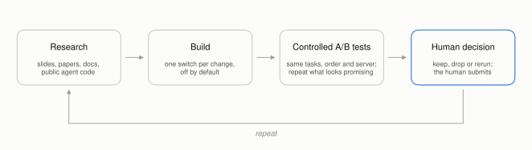
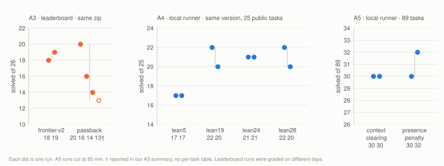
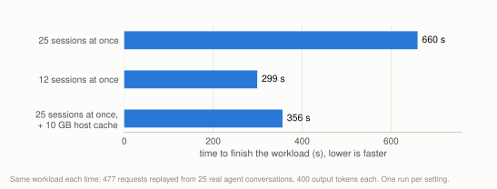
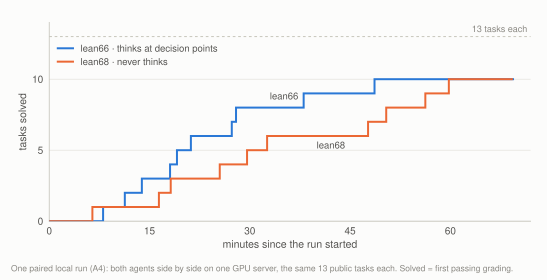

This title summarizes the regular process I used across all my assignments this semester, except A1, which was basically one-shot prompted. For each assignment, I always let my Claude Code make the simplest version that is runnable, then iterate from it to reach higher goals. From those processes, here are the most important 4 lessons I took.

<!--more-->

## 1. Let the agent cook, but own the direction

I was ranked top 1 in A3 and in my presentation I said “let Claude cook”, and I tried to push it further in A4 and A5 and apparently that didn’t go as good as expected (admittedly I have less time to spend on A4A5 but still the results were worse than I’d imagined).

On the one side, I still believe granting coding agents enough permission, autonomy, and trust is important. Agents these days are good, really good. And they’re not only good at coding, but also researching, experimenting, and especially systematically collecting and analyzing results. Also, another perk that humans don’t have: they work 24/7. In many scenarios I found being able to utilize these advantages of AI is super important and it’s my secret to be a 10x efficient contributor when I’m working in fast-moving companies. It shapes my workflow, even used till the end of A5.

Below is a graph illustrating my workflow across all the assignments: me and my agent doing research side by side, choosing a few directions and letting my agent build, then test and gather results and conclusions, finally with some human decisions to enter the next cycle.

However, sometimes I found that when working on deep and hard problems, over reliance on my agent could be harmful and inefficient. There were quite a few examples from A4, where I run many overnight sessions but many times the sessions only explore along one direction or keep iterating on several factors without exploring further. Those overnight sessions might bring the performance higher a bit but tend not to produce very useful information for further improvement, especially if we’re looking for large changes that could improve dramatically.

I think that’s a great lesson telling me the difference between human researchers and AI agents. At the moment I tend to believe agents have relatively fixed context based on the session history and finished research, so experiments initiated by AI are always purely based on that and not creative; whereas humans have very diverse and long thinking history and have way more complex inspiration and ideas. That’s what a lot of people call “taste” in research today, and it’s the first time I feel it’s genuinely so important.

This is the biggest takeaway from the whole semester.

## 2. One good run doesn’t prove much

The second lesson is more straightforward. In the first half of A3, I pretty much never run one version twice, for the sake of maximizing my daily credit. I don’t remember clearly but actually think it was unintentional the first time I submit a version twice - might have selected the wrong file - but then observed pretty large differences between the two runs. It was not just accuracy difference but many times it was also about which questions it got right and which it got wrong.

Below is the graph visualizing some examples from A3/4/5, showcasing the instability I was describing.

The first time it happened I was actually blaming the grader infra changes haha. But as I tried more it was pretty obvious that the infra fluctuations are rather minor but there’s always an inherent level of instability and randomness in different versions (e.g. my A3 passback ver is a good example of high potential but high instability).

That leads to my practice later to freeze each version and experiment with them multiple times, keep good track of the results, separating local ones and online leaderboard, also eventually to the practice to change one thing at a time and don’t stack changes (though I think I have large room to improve there, still not patient enough).

## 3. A good harness depends on the model and hardware

Every time I asked my Claude to migrate An to A(n+1) and make a minimal runnable first attempt, I was expecting a better result but always got a very bad one. That’s where this lesson was mainly from.

For example, in A3 my architecture includes some major design decisions, like 5 independent workers, Standard tries first, Expert for reviewing/ assisting, or fresh retries. Apparently that got pretty good result. But when the same harness directly migrated to A4, with now fixed model and one shared GPU, the minimal migrated first version only got 1/26 - obviously no longer the optimal harness under the new environment.

Below is a chart showing the serving benchmark: the same 477 requests, from 25 real agent conversations.

Again, very clear and straightforward example showing more workers don’t necessarily mean faster, it also depends on concurrency, context, cache, and more.

## 4. Faster actions don’t always mean faster solves

Seeing many classmates benefited from no-thinking mode, I was making the same assumption: no-thinking means faster actions and could lead to more solves.

But it wasn’t the case for me. In A4, I did a paired run with two versions with the only difference being lean66 used adaptive thinking and lean68 was no-thinking. Results are below:

In my case, no-thinking didn’t increase the speed of completion. Faster actions lead to more errors and retries and the results were not better, or even worse, because of them. Again this doesn’t mean no-thinking is absolutely a bad choice. I believe it highly depends on the overall harness design and structure. I see this as a reinforcement of lesson 3 and also showing that harness design is not simply adding things up, many designs are synergistic and influence the performance collectively. While lesson 2 suggests the importance of controlled experiment, this means sometimes synergistic experiments are also necessary and can lead to new findings.

Of course throughout the whole semester I learnt more than these but the above 4 lessons are the most major takeaways and conclude the class nicely for myself. It was an amazing learning journey.

Disclosure: Claude Code assisted to make the images, all data are from real assignment results.
